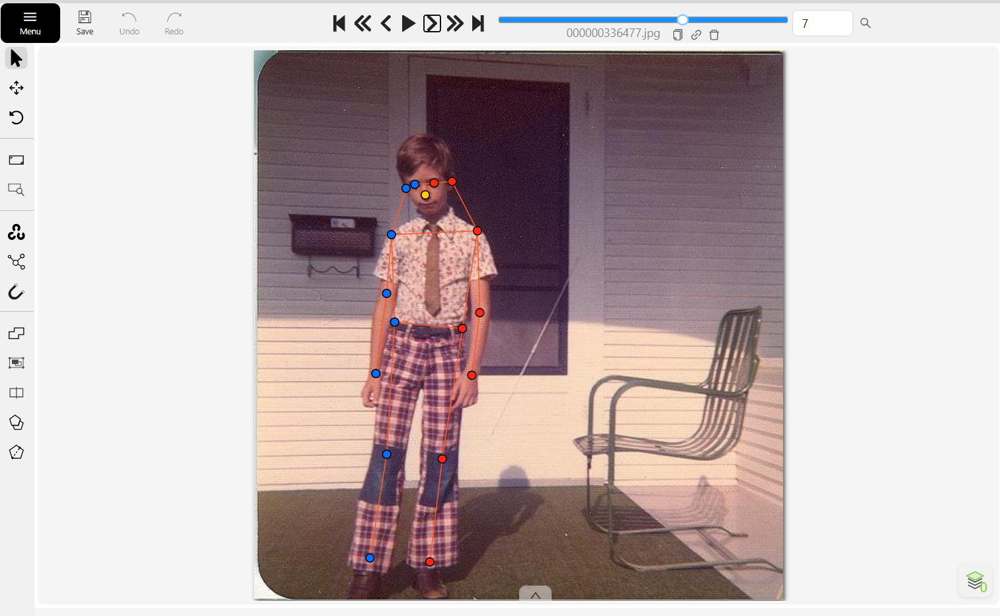
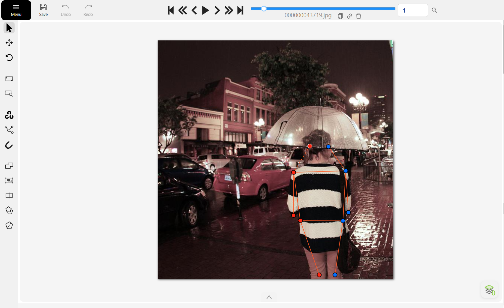
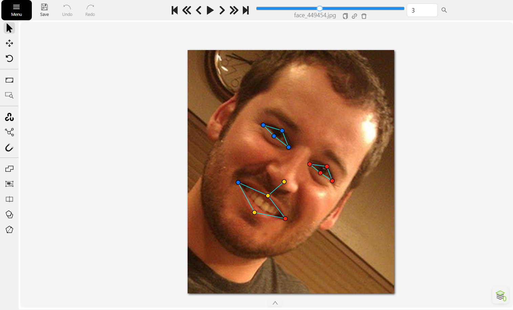

# Báo cáo cá nhân — NguyenThiHuongGiang-2A202603233

## 0. Thông tin học viên

- Họ tên: Nguyễn Thị Hương Giang
- MSSV: 2A202603233
- Email: nthgiang0511@gmail.com
- Link repository: https://github.com/Giang0511/K5-L2-DAY04-NguyenThiHuongGiang-2A202603233-KeypointPose-Student/tree/main/report/individual
- Phiên bản CVAT (Help → About): 2.74.1 (Server version 2.74.1, UI version 2.74.1; tự host, chạy local)
- Máy: hệ điều hành Windows 11 Pro · RAM 64 GB · chạy CVAT chế độ đầy đủ / lite
- Bộ ảnh (`src/exports/assignment.json` do `lab.py setup` tạo): có 
- Giờ bắt đầu: 17h00
- Giờ kết thúc: 19h00

## 1. Kiểm tra label (CP0)

| Label | Kiểu | Số điểm | Tên điểm đúng bảng của lab? | Đúng thứ tự? | Số cạnh |
|---|---|---:|---|---|---:|
| `person` | Skeleton | 17 | Có | Có | 19 |
| `face` | Skeleton | 13 | Có | Có | 13 |

Mẫu `person` dựng theo người quay mặt về camera (các điểm `left_*` nằm bên phải khung mẫu)? **Có** 
Cách đổi cờ `occluded` / `outside` cho **một điểm** trên phiên bản CVAT này :Mở mục PARTS của skeleton trong panel Objects, chọn đúng điểm cần đổi rồi bật cờ `occluded` hoặc `outside` của điểm đó (điểm `occluded` hiển thị bằng nét đứt).

## 2. Số lượng đã gán và thời gian (CP1, CP2)

| Nhóm ảnh | Số ảnh | Số skeleton đã gán | Số người dưới 60 px (không gán) | Số poster / gương / màn hình bỏ qua | Thời gian (phút) |
|---|---:|---:|---:|---:|---:|
| `easy` | 5 | 10 | 0 | 0 | 15 |
| `occluded` | 3 | 16 | 0 | 0 | 20 |
| `back` | 2 | 4 | 0 | 0 | 8 |
| `small` | 1 | 1 | 0 | 0 | 3 |
| `crowd` | 1 | 3 | 0 | 0 | 10 |
| `faces` | 8 | 8 | 0 | 0 | 15 |

- Số ảnh người đã xong ở mốc phút 105: 10 / 10
- Thời gian thực tế (phút): CP1 35 · CP2 25 · CP3 10
- Ảnh tốn thời gian nhất là ảnh nào, vì sao?
Hai ảnh 000000351176.jpg và 000000381889.jpg là những ảnh tốn nhiều
thời gian nhất.
- 000000351176.jpg: Có hai người ở khoảng cách rất khác nhau, gồm
  cầu thủ quay lưng ở gần và trọng tài ngồi trên ghế ở xa. Người ở xa
  có kích thước nhỏ, các điểm keypoint khó xác định và nhãn dễ chồng
  lấn.
- 000000381889.jpg: Có nhiều người đứng gần nhau, tay và vai của
  người này bị người khác che khuất. Vì vậy, cần quan sát kỹ để xác
  định vị trí keypoint và phân biệt giữa v = 1 và v = 0.

## 3. Bảng ca khó (CP1, CP2)

| Ảnh | Người / mặt | Điểm | Cờ đã chọn | Phân vân giữa | Lý do chọn |
|---|---|---:|---:|---|---|
| `000000100510.jpg` | Người kỵ sĩ | Hông, chân bên khuất | 1 | `v = 1` / `v = 0` | Điểm nằm trong khung ảnh, chỉ bị thân ngựa và yên che; vị trí suy ra được từ dáng ngồi nên chọn `occluded` (`v = 1`), không chọn `outside`. |
| `000000381889.jpg` | Người áo xanh | Vai / khuỷu tay bên khuất | 1 | `v = 1` / `v = 0` | Bị người phụ nữ đứng trước che nhưng vẫn trong ảnh, vị trí suy ra được từ thân và cánh tay còn thấy. |
| `face_296767.jpg` | Mặt | 8 điểm mắt sau kính râm | 1 | `v = 2` / `v = 1` | Kính đen che hoàn toàn mắt, không thấy mí mắt; đặt điểm theo cấu trúc khuôn mặt và chọn `occluded`. |
| `face_505385.jpg` | Mặt | Khóe mắt ngoài bên phải | 1 | `v = 1` / `v = 0` | Đầu quay nghiêng nên khóe mắt bị khuất, nhưng vẫn nằm trong ảnh và suy ra được vị trí. |

## 4. Bảng tự review (CP3)

Đi từ ảnh cuối về ảnh đầu: 5 ảnh người (có 3 ảnh `back` hoặc `crowd`) và 3 ảnh mặt.

| Ảnh | Người / mặt | Điểm | Mã lỗi | Ghi chú | Đã sửa? |
|---|---|---|---|---|---|
| `000000516902.jpg` | Người | Toàn bộ skeleton | `ok` | Người quay mặt về camera, điểm `left_*` (đỏ) nằm bên phải ảnh, đúng hướng | Không cần |
| `000000381889.jpg` | Người | Toàn bộ skeleton | `ok` | Hai người đứng sát nhau, nhãn không bị gán nhầm giữa hai người | Không cần |
| `000000351176.jpg` | Người | Toàn bộ skeleton | `ok` | Quay lưng nên `left_*` (đỏ) nằm bên trái ảnh, đúng hướng | Không cần |
| `000000324953.jpg` | Người bên phải ảnh (quay lưng) | Toàn bộ skeleton | `lr_swap` | Ban đầu toàn bộ cặp trái/phải bị gán ngược; đã xác định lại hướng cơ thể và đổi các cặp `left_*` / `right_*` | Có |
| `000000043719.jpg` | Người quay lưng | Toàn bộ skeleton | `ok` | Quay lưng, `left_*` nằm bên trái ảnh, đúng hướng | Không cần |
| `face_81239.jpg` | Mặt | 13 điểm | `ok` | Mắt sau kính thường vẫn nhìn thấy, mắt phải ở bên trái ảnh, đúng | Không cần |
| `face_79367.jpg` | Mặt | 13 điểm | `ok` | Mặt nghiêng, `right_eye` và `mouth_right` ở cùng một phía, đúng | Không cần |
| `face_505385.jpg` | Mặt | 13 điểm | `ok` | Khóe mắt ngoài bị khuất đã đặt `occluded`, các điểm còn lại đúng vị trí | Không cần |

Tổng hợp số lỗi theo mã:

| `lr_swap` | `vis_flag` | `position` | `missing` | `extra` | `ok` |
|---:|---:|---:|---:|---:|---:|
| 1 | 0 | 0 | 0 | 0 | 7 |

Các điểm còn phân vân giữa v = 1 và v = 0:
- 000000100510.jpg: Hông và chân bị ngựa che khuất. Chọn v = 1 vì
  điểm vẫn nằm trong khung hình và có thể suy luận từ tư thế ngồi.
  Không chọn v = 0 vì điểm không nằm ngoài ảnh.
- face_505385.jpg: Khóe mắt ngoài bị khuất do góc nghiêng của đầu.
  Chọn v = 1 vì điểm vẫn thuộc phạm vi ảnh, không phải điểm nằm
  ngoài khung hình.

## 5. Kiểm file xuất và kết quả tự kiểm (CP4)

Tự kiểm tay trong file JSON:

| File | Người / mặt kiểm (ảnh, thứ tự) | Số phần tử `keypoints` | Điểm `outside` ra `v = 0`, `occluded` ra `v = 1`? | `num_keypoints` khớp? |
|---|---|---:|---|---|
| `NguyenThiHuongGiang_persons.zip` | `000000324953.jpg`, người 2 | 51 | Có | Có |
| `NguyenThiHuongGiang_persons.zip` | `000000351176.jpg`, người 2 | 51 | Có | Có |
| `NguyenThiHuongGiang_faces.zip` | `face_505385.jpg`, mặt 1 | 39 | Có | Có |

Sau khi xuất, CVAT ghi `occluded` thành `v = 1` và `outside` thành `v = 0`. Tọa độ của điểm `outside` trong file là `0, 0` hay tọa độ cũ? ___

Hai job đã chuyển sang completed trên CVAT? **Có**

Dán phần **TÓM TẮT** in ra từ `src/check_submission.py`:

File person: NguyenThiHuongGiang_persons.zip
Số ảnh: 12
Số skeleton person: 18
Mỗi annotation: 51 số

Skeleton theo ảnh:
000000021235=1, 000000043719=1, 000000091637=2,
000000100510=2, 000000156069=1, 000000240340=1,
000000324953=2, 000000336477=1, 000000351176=2,
000000381889=3, 000000390585=1, 000000516902=1

Cờ visibility:
v=2: 218 (71%)
v=1: 31 (10%)
v=0: 57 (19%)

num_keypoints trung bình: 13.8

File face: NguyenThiHuongGiang_faces.zip
Số ảnh: 8
Số skeleton face: 8
Mỗi annotation: 39 số

Skeleton theo ảnh:
face_141135=1, face_296767=1, face_380639=1,
face_449454=1, face_469647=1, face_505385=1,
face_79367=1, face_81239=1

Cờ visibility:
v=2: 94 (90%)
v=1: 10 (10%)
v=0: 0 (0%)

num_keypoints trung bình: 13.0

Ghi chú:
57 điểm v=0 vẫn mang tọa độ cũ (CVAT 2.x xuất như vậy;
chuẩn COCO ghi 0, 0). Không phải lỗi: điểm v=0
được bỏ qua khi huấn luyện và khi chấm.

Số [LỖI]: 0
Số [CẢNH BÁO]: 0

Kết quả: ĐẠT

## 6. Ảnh chụp màn hình

1. Label `person` trong label constructor (đủ 17 điểm có tên): 

2. Một người quay lưng đã gán, cờ đã đặt: 

3. Một khuôn mặt đã gán 13 điểm, phóng to vùng mắt: 
   
4. Một đoạn JSON xuất của một người:

   {
            "id": 2,
            "image_id": 2,
            "category_id": 1,
            "segmentation": [],
            "area": 50948.05649999999,
            "bbox": [
                364.87,
                283.19,
                147.27,
                345.95
            ],
            "iscrowd": 0,
            "attributes": {
                "occluded": false,
                "keyframe": false
            },
            "keypoints": [
                449.93,
                280.77,
                0,
                409.88,
                285.19,
                0,
                459.33,
                285.11,
                0,
                408.35,
                283.19,
                1,
                458.48,
                284.85,
                2,
                365.12,
                353.71,
                2,
                505.06,
                349.6,
                2,
                364.87,
                469.17,
                2,
                512.14,
                461.36,
                2,
                342.48,
                434.66,
                0,
                602.55,
                458.57,
                0,
                382.93,
                483.31,
                2,
                497.54,
                483.69,
                2,
                433.83,
                629.14,
                2,
                476.16,
                628.91,
                2,
                409.61,
                520.15,
                0,
                510.86,
                509.82,
                0
            ],
            "num_keypoints": 10
        },

## 7. Tự đánh giá

1. Lỗi bạn mắc nhiều nhất hôm nay, và cách bạn sẽ tránh ở dự án thật:

   Lỗi duy nhất tôi mắc là `lr_swap` ở người quay lưng (`000000324953.jpg`). Tôi gán theo thói quen của người quay mặt về camera, trong khi với người quay lưng thì bên trái cơ thể lại nằm ở bên trái ảnh. Ở dự án thật, tôi sẽ xác định hướng người trước (nhìn mặt, vai, hướng bàn chân) rồi mới gán điểm. Sau đó tôi dùng màu điểm (đỏ là `left_*`, xanh là `right_*`) để rà lại từng skeleton, nhất là các ảnh quay lưng và đám đông.

2. Một quy tắc bạn đề xuất thêm vào guideline (kèm ảnh ví dụ nếu có):

   Thêm một bước bắt buộc: "Với người quay lưng hoặc nghiêng, ghi hướng người (front/back/side) trước khi gán và đối chiếu màu `left_*` / `right_*` với hướng đó ở bước review." Ảnh ví dụ: `000000324953.jpg` và `000000351176.jpg`.

3. Nhãn của bạn đi vào model ở đâu? Chọn một lỗi bạn đã sửa và nói nó sẽ làm model học sai thế nào (heatmap, trọng số trong loss, hay bước lật ảnh):

   Nhãn đi vào target heatmap của từng khớp. Nếu `lr_swap` không được sửa thì heatmap của `left_shoulder` sẽ nằm ở vai phải của người quay lưng, trong khi ở người quay mặt thì lại đúng. Model nhận tín hiệu mâu thuẫn cho cùng một kênh trái/phải và học không ổn định. Lỗi này còn làm hỏng bước lật ảnh: khi lật ngang, pipeline hoán đổi các cặp trái/phải theo bảng cố định, nên nhãn đã sai ban đầu sẽ bị hoán đổi sai thêm một lần nữa.

## 8. Khó khăn và lỗi kỹ thuật

Khó khăn chính là xác định đúng trái/phải khi người trong ảnh quay lưng về camera. Tôi khắc phục bằng cách quan sát hướng cơ thể và đối chiếu vị trí các bộ phận trước khi sửa nhãn. Khó khăn thứ hai là ở ảnh có người ở xa hoặc đông người, các nhãn tên điểm chồng lên nhau nên khó chọn đúng điểm; tôi phóng to ảnh và gán từng người một. Không gặp lỗi kỹ thuật nào đáng kể.

## Bonus (nếu làm)

### B1 — 3 ảnh người khó thêm

| Ảnh | Số skeleton | Số người dưới 60 px | Ca khó nhất |
|---|---:|---:|---|
| 000000373426.jpg | 3| 0 | không có |
| 000000465508.jpg | 3 | 0 | không có |
| 000000565600.jpg | 3 | 0 | người đứng xa camera nhấ |

Kết quả `src/check_submission.py` cho `NguyenThiHuongGiang_bonus_persons.zip`:

- File person: NguyenThiHuongGiang_bonus_persons.zip
  Số ảnh: 3 · số skeleton `person`: 9 · mỗi annotation 51 số
  Skeleton theo ảnh: 000000373426=3, 000000465508=3, 000000565600=3
  Cờ v: v=2 89 (58%) · v=1 17 (11%) · v=0 47 (31%)
  num_keypoints trung bình: 11.8
- Ghi chú: 47 điểm v = 0 vẫn mang tọa độ cũ (CVAT 2.x xuất như vậy; chuẩn COCO ghi 0, 0). Không phải lỗi: điểm v = 0 bị bỏ qua khi huấn luyện và khi chấm.
- Số [LỖI]: 0 · số [CẢNH BÁO]: 0
Kết quả: ĐẠT

### B2 — 5 ảnh khuôn mặt đen trắng / hồng ngoại

Ảnh không màu làm mất thông tin màu giữa môi, da, lòng đen và vùng xung quanh, nên phải dựa vào hình dạng, độ tương phản và đường viền của mắt, mũi, miệng. Kính râm trên ảnh hồng ngoại: nếu mắt vẫn bị kính che (không thấy mí mắt hay lòng đen) thì vẫn là `v = 1`; nếu ảnh hồng ngoại xuyên qua kính và nhìn thấy mắt rõ thì có thể gán `v = 2`.

## 9. Tài liệu tham khảo và công cụ AI đã dùng

- CVAT (Computer Vision Annotation Tool).
- Claude (Anthropic), chatGPT: hỗ trợ sắp xếp, định dạng và hoàn thiện báo cáo; nội dung quan sát và gán nhãn do tôi thực hiện.
